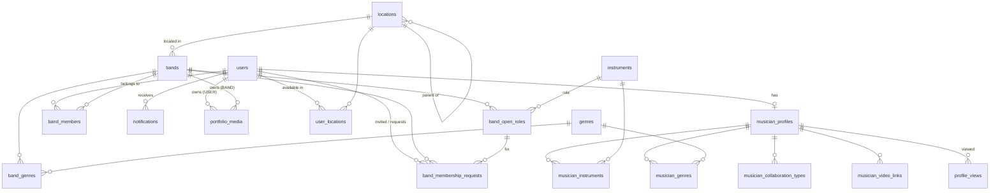

# SoundCircle — schema design

**What the database is.** Every table, column, enum, index and rule the requirements need, grouped by domain. [`coding-standards.md`](coding-standards.md) owns *how* each table is written in code; this document owns *what* exists. **This document wins** where they disagree.

**Status.** `users`, `user_locations` (§4.1) and `locations` (§4.2) are built; `users` lags this design (§8). Everything else is designed here and not yet implemented.

## Contents

1. [Conventions](#1-conventions) · 2. [ERD](#2-erd) · 3. [Enums](#3-enums) · 4. [Tables](#4-tables) · 5. [Rules](#5-rules) · 6. [Discovery queries](#6-discovery-queries) · 7. [Requirement → table map](#7-requirement--table-map) · 8. [Build status](#8-build-status)

---

## 1. Conventions

Applies to every table below. Never repeated per table.

| Rule | Detail |
|---|---|
| Database | PostgreSQL 18 with **PostGIS 3.6** (`postgis/postgis:18-3.6-alpine` locally; the `locations` migration enables the extension), TypeORM migrations, `synchronize: false` |
| Primary key | `id int GENERATED BY DEFAULT AS IDENTITY`. Never `uuid` |
| Foreign keys | `int`, named `<table>_fk_<column>`. `ON DELETE NO ACTION` unless stated, because rows are soft-deleted rather than removed |
| Names | `snake_case` tables (plural) and columns; the TS property name is the column name |
| Enums | `smallint` holding the numeric value (§3). Values are contract: never renumbered, and a retired value stays burnt |
| Time | `timestamptz` everywhere; `date` only for a calendar day |
| Common columns | Every table ends with `row_status smallint default 1`, `created_at`, `updated_at`, `deleted_at`, `created_by`, `updated_by`, `deleted_by`, `created_ip`, `updated_ip`, `deleted_ip`. These come from `AbstractEntity` / `commonColumns` and are **not listed per table** |
| Deletes | Soft delete only (`softRemove()`, which stamps `deleted_by` / `deleted_ip`). Every read filters `deleted_at IS NULL` |
| Uniqueness | Any unique rule on a soft-deletable row is a **partial** unique index `WHERE deleted_at IS NULL`, so a deleted row frees its value |
| Constraint names | `<table>_uq_<cols>`, `<table>_idx_<cols>`, `<table>_fk_<col>`, `<table>_ck_<rule>`, pinned on the entity as well as the migration |
| Files | Binary content never touches the database or the API server. It lives on Cloudinary; a row keeps the `public_id` and `secure_url` only (§4.3) |

`row_status` values (shared): `INACTIVE = 0`, `ACTIVE = 1`, `PENDING = 2`, `REJECTED = 3`, `ARCHIVED = 4`.

---

## 2. ERD



The two `portfolio_media` lines are drawn for reading only: `owner_id` is polymorphic and has no foreign key (§4.3). `contact_messages` stands alone (a contact message may come from a visitor).

---

## 3. Enums

All `smallint`. The **column** they live in is given so a reader can find them in §4.

| Enum | Column(s) | Values |
|---|---|---|
| `ContactVisibility` | `users.email_visibility`, `users.phone_visibility` | `PUBLIC = 1` · `MEMBERS = 2` (any signed-in user) · `BAND_MATES = 3` (shares an active band) · `ONLY_ME = 4` |
| `LocationLevel` | `locations.level` | `DIVISION = 1` · `DISTRICT = 2` · `SUBDISTRICT = 3` (upazila or city corporation) · `LOCALITY = 4` (thana or area) |
| `LocationType` | `locations.type` | `DIVISION = 1` · `DISTRICT = 2` · `UPAZILA = 3` · `CITY_CORPORATION = 4` · `THANA = 5` · `AREA = 6` |
| `ExperienceLevel` | `musician_profiles.experience_level` | `BEGINNER = 1` · `INTERMEDIATE = 2` · `ADVANCED = 3` · `PROFESSIONAL = 4` |
| `Availability` | `musician_profiles.availability` | `AVAILABLE = 1` · `LIMITED = 2` · `NOT_AVAILABLE = 3` |
| `CollaborationType` | `musician_collaboration_types.collaboration_type` | `JOIN_BAND = 1` · `SESSION_WORK = 2` · `JAMMING = 3` · `ONLINE_COLLAB = 4` · `TEACHING = 5` |
| `SkillLevel` | `musician_instruments.skill_level` | same values as `ExperienceLevel` |
| `MediaOwnerType` | `portfolio_media.owner_type` | `USER = 1` · `BAND = 2` |
| `MediaType` | `portfolio_media.media_type` | `IMAGE = 1` · `VIDEO = 2` · `AUDIO = 3` |
| `VideoProvider` | `musician_video_links.provider` | `YOUTUBE = 1` · `VIMEO = 2` |
| `BandMemberRole` | `band_members.role` | `OWNER = 1` · `MEMBER = 2` |
| `BandLeaveReason` | `band_members.leave_reason` | `LEFT = 1` · `REMOVED = 2` |
| `OpenRoleStatus` | `band_open_roles.status` | `OPEN = 1` · `FILLED = 2` · `CLOSED = 3` |
| `MembershipRequestType` | `band_membership_requests.type` | `INVITATION = 1` (band → musician) · `JOIN_REQUEST = 2` (musician → band) |
| `MembershipRequestStatus` | `band_membership_requests.status` | `PENDING = 1` · `ACCEPTED = 2` · `DECLINED = 3` · `CANCELLED = 4` · `EXPIRED = 5` |
| `NotificationType` | `notifications.type` | `INVITATION_RECEIVED = 1` · `INVITATION_ACCEPTED = 2` · `INVITATION_DECLINED = 3` · `JOIN_REQUEST_RECEIVED = 4` · `JOIN_REQUEST_ACCEPTED = 5` · `JOIN_REQUEST_DECLINED = 6` · `REMOVED_FROM_BAND = 7` · `PROFILE_VIEWED = 8` |
| `ContactMessageStatus` | `contact_messages.status` | `NEW = 1` · `READ = 2` · `RESOLVED = 3` |

---

## 4. Tables

Column lists omit `id` and the common columns (§1).

### 4.1 Identity and auth

**Auth has no table.** Login is email or phone + password. On success the API sets two `httpOnly`, `Secure`, `SameSite` cookies: a short-lived access JWT (15 min) and a refresh JWT. Both are stateless; nothing about a session is stored.

⚠ A stateless refresh token **cannot be revoked** before it expires: logout only clears the cookies. Keep the refresh lifetime short. If "sign out of all devices" is ever needed, add a token table then.

#### `users` ✅ built

One row per account.

| Column | Type | Null | Notes |
|---|---|---|---|
| `name` | `varchar(100)` | no | Display name. Profile setup step 1 edits it |
| `email` | `varchar(255)` | yes | Stored lower-cased |
| `phone` | `varchar(20)` | yes | E.164, e.g. `+8801712345678` |
| `password_hash` | `varchar(255)` | no | `scrypt$<salt>$<hash>`. Every account has one, since password is the only way in. **Never selected by a read** |
| `email_verified_at` | `timestamptz` | yes | |
| `phone_verified_at` | `timestamptz` | yes | |
| `email_visibility` | `smallint` | no | `ContactVisibility`, default `ONLY_ME (4)` |
| `phone_visibility` | `smallint` | no | `ContactVisibility`, default `ONLY_ME (4)` |
| `last_login_at` | `timestamptz` | yes | |

| Constraint | Definition |
|---|---|
| `users_uq_email` | unique `(email) WHERE deleted_at IS NULL` |
| `users_uq_phone` | unique `(phone) WHERE deleted_at IS NULL` |
| `users_ck_email_or_phone` | `CHECK (email IS NOT NULL OR phone IS NOT NULL)`: an account must have a login |

#### `user_locations` ✅ built

Where the user is **available to join a band**, not where they live. Keyed by user, so it is filled in at signup, before a profile exists.

| Column | Type | Null | Notes |
|---|---|---|---|
| `user_id` | `int` | no | FK `users` |
| `location_id` | `int` | no | FK `locations`, any level |

Indexes: `user_locations_uq_user_id_location_id` unique `WHERE deleted_at IS NULL` · `user_locations_idx_location_id` (matching starts here, §5.4).

**The picker** is four cascading dropdowns (1 Division → 2 District → 3 City Corporation / Upazila → 4 Thana / Area), each filled from `GET /api/v1/locations`:

1. `?level=1` fills the divisions.
2. Choosing a row fills the next dropdown with `?parent_id=<its id>`. Its first option is **"All of <the row above>"**, which stops there. Steps 3 and 4 group their options by `type`: city corporations before upazilas, thanas before areas.
3. A row with `child_count = 0` leaves the next dropdown disabled.
4. **Add location** stores the deepest choice as a chip. The user repeats for as many places as they like, across any divisions.
5. Signup sends the chips as `location_ids` on `POST /api/v1/users`.

| User action | Rows stored |
|---|---|
| "All of Dhaka division" | one row: the division |
| Specific districts, upazilas, city corporations, thanas or areas | one row each |
| Picks in another division | more rows: any mix, across any divisions |

A pick at any level is **one row**. Its children are included by matching (§5.4) and never expanded into rows, so a place added to the tree later is covered automatically.

**Saving** happens in the user's create transaction. The service rejects unknown ids (400) and drops a pick another pick already covers (Dhaka division + Savar → Dhaka division). The DTO caps the list at 20 and rejects duplicates.

⚠ **Editing the set after signup waits for auth.** It will be a `PUT` that replaces the whole set for the signed-in user. A public route keyed by a user id would let anyone rewrite anyone's locations.

### 4.2 Reference data

Seeded, admin-editable lists. Filters pass ids.

#### `instruments`

| Column | Type | Null | Notes |
|---|---|---|---|
| `name` | `varchar(60)` | no | Guitar, Drums, Bass, Vocals, Keyboard, … `instruments_uq_name` unique `WHERE deleted_at IS NULL` |
| `sort_order` | `smallint` | no | default 0 |

⚠ **A band role is an instrument.** "Looking for a drummer" is `band_open_roles.instrument_id` = Drums, so a role search and an instrument search are the same query. "Vocals" is an instrument row for this reason.

#### `genres`

| Column | Type | Null | Notes |
|---|---|---|---|
| `name` | `varchar(60)` | no | `genres_uq_name` unique `WHERE deleted_at IS NULL` |
| `sort_order` | `smallint` | no | default 0 |

#### `locations` ✅ built

Bangladesh's administrative tree, four levels deep. Each place may carry its **centre point** for "near" searches. That is a property of the place, never of a user: no GPS, no maps API, and nothing records where a musician lives.

| `level` | `type` | Parent |
|---|---|---|
| 1 `DIVISION` | `DIVISION` | — |
| 2 `DISTRICT` | `DISTRICT` | division |
| 3 `SUBDISTRICT` | `UPAZILA` or `CITY_CORPORATION` | district |
| 4 `LOCALITY` | `THANA` (metropolitan, under a city corporation) or `AREA` | subdistrict |

**`level` is the depth** and drives matching; **`type` is what kind of place it is** and drives display (the picker groups "City Corporation" before "Upazila"). Matching never reads `type`.

| Column | Type | Null | Notes |
|---|---|---|---|
| `parent_id` | `int` | yes | FK `locations`. Null for a division |
| `level` | `smallint` | no | `LocationLevel` |
| `type` | `smallint` | no | `LocationType` |
| `name` | `varchar(100)` | no | English |
| `name_bn` | `varchar(100)` | yes | Bangla |
| `center_point` | `geography(Point, 4326)` | yes | The place's centre (PostGIS, WGS 84). Null where the source has none |
| `division_id` | `int` | no | FK `locations`. The division this row is in; its own id for a division |
| `district_id` | `int` | yes | FK `locations`. Its district; own id for a district; null for a division |
| `subdistrict_id` | `int` | yes | FK `locations`. Its upazila or city corporation; own id at that level; null above it |

Each row carries its ancestors, and itself at its own level. The depth is fixed at four, so every hierarchy question is an integer comparison, with no recursion and no string matching:

| Row | `level` · `type` | `division_id` | `district_id` | `subdistrict_id` |
|---|---|---|---|---|
| Dhaka (30) | 1 · `DIVISION` | 30 | — | — |
| Dhaka (3026) | 2 · `DISTRICT` | 30 | 3026 | — |
| Savar (30260072) | 3 · `UPAZILA` | 30 | 3026 | 30260072 |
| Dhaka North City Corporation (302601) | 3 · `CITY_CORPORATION` | 30 | 3026 | 302601 |
| Shah Ali (302601566) | 4 · `THANA` | 30 | 3026 | 302601 |

**Location P covers location X** (X is P or lies inside it) when `P.id IN (X.division_id, X.district_id, X.subdistrict_id, X.id)`. In code: `locationCovers()` in `location.util.ts`.

**Ids are derived, never generated**, so the same place has the same id in every environment and the seed is an upsert on `id`:

| Rows | Id |
|---|---|
| division, district, upazila | the BBS geocode without `BD`: Dhaka `BD30` → 30, `BD3026` → 3026, Savar `BD30260072` → 30260072 |
| city corporation | district × 100 + its source number: Dhaka North (`cc-01`) → 302601 |
| metropolitan thana | city corporation × 1000 + its source number: Shah Ali (`tha-0566`) → 302601566 |

The bands cannot overlap (6 and 9 digits against 8-digit upazilas) and stay under int4. The seed then moves the identity sequence past the largest id, so a row added without one (an area) cannot collide.

Indexes: `locations_idx_parent_id` (the picker loads one level at a time) · `locations_idx_center_point`, GiST on `center_point` (what `ST_DWithin` uses). TypeORM models both the `geography` column and the spatial index, so `migration:generate` sees them.

**Centre points.** Districts and upazilas take theirs from the BBS files. A division is the average of its districts' points, which is approximate but only "near" searches read it. City corporations and thanas have none in their source, so they are null and never match a "near" search. The seeder rejects any point outside Bangladesh's bounding box, which is how a swapped latitude/longitude shows up.

**Near search** (`GET /locations?near_location_id=&radius_km=`) measures between place centres:

```sql
FROM locations
JOIN locations origin ON origin.id = :near_location_id AND origin.deleted_at IS NULL
WHERE ST_DWithin(locations.center_point, origin.center_point, :radius_km * 1000)  -- metres, uses the GiST index
ORDER BY ST_Distance(locations.center_point, origin.center_point)
```

It is an extra, not a replacement: matching (§5.4) stays containment ("Dhaka division covers Savar"). Distance answers a different question, "what is close to Savar across a boundary" (Dhamrai 15.7 km, Singair 16.8 km).

**Seed data.** `yarn seed:run`, after `yarn migration:run`. Sources in `libs/shared/src/database/seeds/data/locations/`, giving 689 rows:

| File | Gives |
|---|---|
| `all-district.json` | 64 districts, and the 8 divisions from their `parent` |
| `all-upazila.json` | 495 upazilas |
| `bangladesh-geo-data/city_corporations.json` | 12 city corporations (npm `bangladesh-geo-data` 4.0.9, MIT) |
| `bangladesh-geo-data/thanas.json` | 110 metropolitan thanas; its rural and sub-district thanas are skipped, as they duplicate or sit inside upazilas |

`bangladesh-geo-data` has its own district ids, so the seeder matches its districts to the BBS ones by name, with an alias table for the five spelt differently (Jessore → Jashore, …).

⚠ **No areas yet**, and Cumilla City Corporation has no thanas in the source. Adding either is a data change: another source file and seeder rows at `LOCALITY` level.

### 4.3 Media

#### `portfolio_media`

A musician's or a band's portfolio: images, videos and audio, **stored and served by Cloudinary**. The database keeps metadata only.

**Upload flow** (signed uploads; the Cloudinary API secret never leaves the server):

1. `POST /media/upload-signature` with `owner_type` (+ `owner_id` for a band). NestJS checks the caller may write to that owner, then signs the upload parameters (timestamp, folder `soundcircle/<owner_type>/<owner_id>`, allowed formats) and returns the signature, timestamp, API key, cloud name and folder.
2. The frontend uploads the file straight to Cloudinary.
3. Cloudinary returns `public_id`, `secure_url`, `version`, `signature` and the file metadata.
4. The frontend sends that result to `POST /media`. NestJS verifies Cloudinary's response signature, checks that `public_id` sits inside the folder it signed, and saves the row.
5. The frontend displays media from `secure_url`.

**Delete** soft-removes the row and destroys the Cloudinary asset by `public_id`.

| Column | Type | Null | Notes |
|---|---|---|---|
| `owner_type` | `smallint` | no | `MediaOwnerType` |
| `owner_id` | `int` | no | `users.id` or `bands.id`, per `owner_type`. **No FK** |
| `media_type` | `smallint` | no | `MediaType`. Cloudinary's `resource_type` is `image` for `IMAGE` and `video` for `VIDEO` and `AUDIO` |
| `file_name` | `varchar(255)` | yes | Original name, display only |
| `public_id` | `varchar(255)` | no | Cloudinary id, used to transform or delete. `portfolio_media_uq_public_id` unique `WHERE deleted_at IS NULL` |
| `secure_url` | `text` | no | HTTPS delivery URL |
| `thumbnail_url` | `text` | yes | Video only |
| `mime_type` | `varchar(100)` | no | |
| `file_size` | `bigint` | no | Bytes |
| `caption` | `text` | yes | Max 500 characters (DTO) |

Index: `portfolio_media_idx_owner_type_owner_id`. Limit: 20 per owner, enforced in the service.

⚠ **`owner_id` has no foreign key**, because it points at two tables. The service checks that the owner exists and that the caller may write to it (self for `USER`, band owner for `BAND`), and soft-deletes an owner's media when it soft-deletes the owner.

The **profile photo** and **band logo** are not portfolio items. They use the same signed flow and are stored as two columns on their row (`musician_profiles.photo_*`, `bands.logo_*`).

### 4.4 Musician profile

#### `musician_profiles`

One per user, created at profile setup step 1. Name comes from `users.name`.

| Column | Type | Null | Notes |
|---|---|---|---|
| `user_id` | `int` | no | FK `users`. `musician_profiles_uq_user_id` unique `WHERE deleted_at IS NULL` |
| `slug` | `varchar(120)` | no | Public URL `/musicians/:slug`. `musician_profiles_uq_slug` unique `WHERE deleted_at IS NULL` |
| `headline` | `varchar(120)` | yes | Step 1 |
| `bio` | `text` | yes | Step 1, max 2,000 characters (DTO) |
| `experience_level` | `smallint` | yes | `ExperienceLevel`. Step 1 |
| `years_of_experience` | `smallint` | yes | Step 1 |
| `availability` | `smallint` | yes | `Availability`. Step 1 |
| `photo_public_id` | `varchar(255)` | yes | Cloudinary id of the profile photo. Step 3 |
| `photo_url` | `text` | yes | Its `secure_url` |
| `setup_step` | `smallint` | no | default 0: the last completed step, 0–3 |
| `profile_completion` | `smallint` | no | default 0, 0–100. Recomputed by the service on every profile write (§5.3) |
| `is_discoverable` | `boolean` | no | default false. True once step 2 is done (has at least one instrument), so empty profiles stay out of search |

Indexes: `_idx_availability` · `_idx_experience_level` · `_ck_profile_completion` `CHECK (profile_completion BETWEEN 0 AND 100)`.

#### `musician_instruments` — step 2

| Column | Type | Null | Notes |
|---|---|---|---|
| `musician_profile_id` | `int` | no | FK `musician_profiles` |
| `instrument_id` | `int` | no | FK `instruments` |
| `skill_level` | `smallint` | yes | `SkillLevel` |
| `is_primary` | `boolean` | no | default false. At most one per profile |

Indexes: `_uq_musician_profile_id_instrument_id` unique `WHERE deleted_at IS NULL` · `_uq_musician_profile_id_primary` unique `(musician_profile_id) WHERE is_primary AND deleted_at IS NULL` · `_idx_instrument_id`.

#### `musician_genres` — step 2

| Column | Type | Null | Notes |
|---|---|---|---|
| `musician_profile_id` | `int` | no | FK `musician_profiles` |
| `genre_id` | `int` | no | FK `genres` |

Indexes: `_uq_musician_profile_id_genre_id` unique `WHERE deleted_at IS NULL` · `_idx_genre_id`.

#### `musician_collaboration_types` — step 1

What the musician is open to. Backs the "collaboration" filter.

| Column | Type | Null | Notes |
|---|---|---|---|
| `musician_profile_id` | `int` | no | FK `musician_profiles` |
| `collaboration_type` | `smallint` | no | `CollaborationType` |

Indexes: `_uq_musician_profile_id_collaboration_type` unique `WHERE deleted_at IS NULL` · `_idx_collaboration_type`.

#### `musician_video_links` — step 3

YouTube / Vimeo links. Uploaded files go to `portfolio_media` instead.

| Column | Type | Null | Notes |
|---|---|---|---|
| `musician_profile_id` | `int` | no | FK `musician_profiles` |
| `provider` | `smallint` | no | `VideoProvider` |
| `external_video_id` | `varchar(32)` | no | Parsed from the URL on save; the embed is built from this, never from the raw URL |
| `url` | `varchar(512)` | no | As entered |
| `title` | `varchar(120)` | yes | |
| `sort_order` | `smallint` | no | default 0 |

Index: `_uq_musician_profile_id_provider_external_video_id` unique `WHERE deleted_at IS NULL`. Limit: 5 per profile.

### 4.5 Bands

#### `bands`

| Column | Type | Null | Notes |
|---|---|---|---|
| `name` | `varchar(100)` | no | |
| `slug` | `varchar(120)` | no | Public URL `/bands/:slug`. `bands_uq_slug` unique `WHERE deleted_at IS NULL` |
| `logo_public_id` | `varchar(255)` | yes | Cloudinary id of the logo |
| `logo_url` | `text` | yes | Its `secure_url` |
| `bio` | `text` | yes | |
| `location_id` | `int` | no | FK `locations`, any level. Musicians are matched against it (§5.4) |
| `setup_step` | `smallint` | no | default 0. Drives the creation progress bar: 1 details, 2 genres, 3 roles, 4 invitations sent |

Index: `bands_idx_location_id`.

⚠ **No `owner_id` column.** Ownership is the `band_members` row with `role = OWNER` (§4.5 `band_members`), so it cannot disagree with membership. `created_by` records who created the band.

#### `band_genres`

| Column | Type | Null | Notes |
|---|---|---|---|
| `band_id` | `int` | no | FK `bands` |
| `genre_id` | `int` | no | FK `genres` |

Index: `_uq_band_id_genre_id` unique `WHERE deleted_at IS NULL`.

#### `band_members`

Membership history. A current member is a row with `left_at IS NULL`.

| Column | Type | Null | Notes |
|---|---|---|---|
| `band_id` | `int` | no | FK `bands` |
| `user_id` | `int` | no | FK `users` |
| `role` | `smallint` | no | `BandMemberRole` |
| `instrument_id` | `int` | yes | FK `instruments`: what they play in this band |
| `joined_at` | `timestamptz` | no | |
| `left_at` | `timestamptz` | yes | |
| `leave_reason` | `smallint` | yes | `BandLeaveReason` |
| `removed_by_user_id` | `int` | yes | FK `users`. Set when `leave_reason = REMOVED` |

| Constraint | Definition |
|---|---|
| `band_members_uq_band_id_user_id_current` | unique `(band_id, user_id) WHERE left_at IS NULL AND deleted_at IS NULL`: one live membership per person |
| `band_members_uq_band_id_owner` | unique `(band_id) WHERE role = 1 AND left_at IS NULL AND deleted_at IS NULL`: **exactly one owner** at a time |
| `band_members_ck_left` | `CHECK ((left_at IS NULL) = (leave_reason IS NULL))` |
| `band_members_idx_user_id` | "My bands" on the dashboard |

#### `band_open_roles`

The roles a band is looking for.

| Column | Type | Null | Notes |
|---|---|---|---|
| `band_id` | `int` | no | FK `bands` |
| `instrument_id` | `int` | no | FK `instruments` |
| `description` | `varchar(500)` | yes | |
| `status` | `smallint` | no | `OpenRoleStatus`, default `OPEN` |
| `filled_by_user_id` | `int` | yes | FK `users`. Set when an accepted request fills it |

Index: `_idx_band_id_status`.

#### `band_membership_requests`

One table for **both directions**: invitations (band → musician) and join requests (musician → band). The dashboard's incoming/outgoing lists and the owner's join-request queue all read it.

| Column | Type | Null | Notes |
|---|---|---|---|
| `band_id` | `int` | no | FK `bands` |
| `user_id` | `int` | no | FK `users`: the musician, in both directions |
| `type` | `smallint` | no | `MembershipRequestType` |
| `open_role_id` | `int` | yes | FK `band_open_roles` |
| `instrument_id` | `int` | yes | FK `instruments` |
| `message` | `varchar(1000)` | yes | |
| `status` | `smallint` | no | `MembershipRequestStatus`, default `PENDING` |
| `sent_by_user_id` | `int` | no | FK `users`: the owner for an invitation, the musician for a request |
| `responded_by_user_id` | `int` | yes | FK `users` |
| `responded_at` | `timestamptz` | yes | |
| `expires_at` | `timestamptz` | no | 30 days after send. A sweep marks overdue rows `EXPIRED` |

| Constraint | Definition |
|---|---|
| `_uq_band_id_user_id_pending` | unique `(band_id, user_id) WHERE status = 1 AND deleted_at IS NULL`: no duplicate open invitation/request |
| `_idx_user_id_status` | musician's incoming invitations / outgoing requests |
| `_idx_band_id_status` | owner's outgoing invitations / incoming requests |

**Accepting** runs in one transaction: lock the request row → re-check `PENDING` → set `ACCEPTED` → insert `band_members` → fill `open_role_id` → insert the notification. A second accept loses the lock race and gets 409.

| Viewer | Incoming | Outgoing |
|---|---|---|
| Musician | `type = INVITATION AND user_id = me` | `type = JOIN_REQUEST AND user_id = me` |
| Band owner | `type = JOIN_REQUEST AND band_id IN (my owned bands)` | `type = INVITATION AND band_id IN (my owned bands)` |

### 4.6 Activity

#### `notifications`

| Column | Type | Null | Notes |
|---|---|---|---|
| `user_id` | `int` | no | FK `users`: the recipient |
| `type` | `smallint` | no | `NotificationType` |
| `actor_user_id` | `int` | yes | FK `users` |
| `band_id` | `int` | yes | FK `bands` |
| `membership_request_id` | `int` | yes | FK `band_membership_requests` |
| `data` | `jsonb` | yes | Render-only extras. Never queried |
| `read_at` | `timestamptz` | yes | |

Index: `notifications_idx_user_id_read_at`, which serves the unread badge and the dashboard list.

#### `profile_views`

At most one row per viewer, per profile, per day. That is enough for a "profile views" count without storing every page hit.

| Column | Type | Null | Notes |
|---|---|---|---|
| `musician_profile_id` | `int` | no | FK `musician_profiles` |
| `viewer_user_id` | `int` | yes | FK `users`. Null for a visitor |
| `viewer_key` | `varchar(64)` | no | `u:<user_id>`, or `a:<sha256(ip + user agent + daily salt)>` for a visitor. Raw IPs are never stored here |
| `view_date` | `date` | no | |

Index: `profile_views_uq_profile_viewer_date` unique `(musician_profile_id, viewer_key, view_date)`, so the insert is `ON CONFLICT DO NOTHING`. An owner viewing their own profile is not recorded.

### 4.7 Public site

#### `contact_messages`

| Column | Type | Null | Notes |
|---|---|---|---|
| `user_id` | `int` | yes | FK `users`, when signed in |
| `name` | `varchar(100)` | no | |
| `email` | `varchar(255)` | no | |
| `subject` | `varchar(200)` | no | |
| `message` | `text` | no | Max 5,000 characters (DTO) |
| `status` | `smallint` | no | `ContactMessageStatus`, default `NEW` |

Landing, How It Works, About, Community Guidelines and Privacy Policy are **static frontend pages**, with no table. SEO (SSR/ISR, meta tags, Open Graph) is frontend work too. The database supplies the `slug` on profiles and bands, and `updated_at` for sitemap `lastmod` and ISR revalidation.

---

## 5. Rules

### 5.1 Contact visibility

`users.email_visibility` / `phone_visibility` decide whether a reader sees the value. **It is applied in the repository's SELECT**: a hidden value comes back as `null`, never fetched and then dropped.

| Setting | Visitor | Signed-in user | Band mate (active member of a shared band) | Self |
|---|---|---|---|---|
| `PUBLIC` | ✅ | ✅ | ✅ | ✅ |
| `MEMBERS` | — | ✅ | ✅ | ✅ |
| `BAND_MATES` | — | — | ✅ | ✅ |
| `ONLY_ME` | — | — | — | ✅ |

⚠ A masked column is **not sortable or searchable**. Ordering or filtering by a hidden email leaks it one comparison at a time.

### 5.2 Permissions

| Action | Visitor | Signed-in | Band member | Band owner |
|---|---|---|---|---|
| Search musicians, view public profiles / bands | ✅ | ✅ | ✅ | ✅ |
| Edit own profile, upload own portfolio media | — | ✅ (own only) | ✅ | ✅ |
| Create a band (creator becomes `OWNER`) | — | ✅ | ✅ | ✅ |
| Send a join request | — | ✅ | — (already a member) | — |
| See member-only band view (full member list, contact per §5.1) | — | — | ✅ | ✅ |
| Leave the band | — | — | ✅ | — (transfer ownership first) |
| Edit band details, logo, genres, open roles, band portfolio | — | — | — | ✅ |
| Send invitations, accept/decline join requests | — | — | — | ✅ |
| Remove a member (UI confirms first; writes `left_at`, `leave_reason = REMOVED`) | — | — | — | ✅ |
| Delete the band | — | — | — | ✅ |

Roles are read from `band_members` on every request. **There is no permission table**: two roles do not justify an RBAC catalogue. If an admin back-office arrives, it gets its own.

### 5.3 Profile completion

Recomputed and stored on every profile write, so the dashboard and discovery read a column rather than compute it:

| Item | Weight |
|---|---|
| Headline | 10 |
| Bio | 15 |
| ≥ 1 available location | 10 |
| Experience level + availability | 10 |
| ≥ 1 instrument | 20 |
| ≥ 1 genre | 10 |
| Profile photo | 15 |
| ≥ 1 portfolio item or video link | 10 |
| **Total** | **100** |

### 5.4 Location matching

A musician is available for a band when one of their `user_locations` **covers** the band's location (§4.2), or the band's location covers it (the band named only a wider area). The band's location row `b` is read once; the rest is integer equality:

```sql
EXISTS (
  SELECT 1
  FROM user_locations ul
  JOIN locations l ON l.id = ul.location_id
  WHERE ul.user_id = u.id
    AND ul.deleted_at IS NULL
    AND (ul.location_id IN (:b_division_id, :b_district_id, :b_subdistrict_id, :b_id)  -- the musician's pick covers the band
      OR :b_id IN (l.division_id, l.district_id, l.subdistrict_id))                      -- the band named a wider location
)
```

The first branch needs no join and runs on `user_locations_idx_location_id`, which is the common case.

| Musician picked | Band is in | Match |
|---|---|---|
| Dhaka (division) | Savar | ✅ the division covers every child |
| Dhaka (district) | Mirpur | ✅ |
| Mirpur | Mirpur | ✅ |
| Mirpur | Dhanmondi | — |
| Mirpur | Dhaka (district) | ✅ the band named only the district, and Mirpur is in it |
| Chattogram (division) + Mirpur | Gulshan | — neither pick covers Gulshan |

### 5.5 Suggested musicians

Computed on the fly, not stored: discoverable profiles that share a genre with the user, play an instrument the user's bands have an `OPEN` role for, and are available in one of those bands' locations (§5.4). Ranked by overlap count, then newest. Users already in a band with the viewer are excluded.

---

## 6. Discovery queries

`GET /musicians` (public) reads `users` ⨝ `musician_profiles WHERE is_discoverable AND deleted_at IS NULL`.

| Filter | Predicate |
|---|---|
| `search` | `users.name ILIKE :q` **or** `EXISTS` an instrument with `name ILIKE :q`. Name search uses a `pg_trgm` GIN index `users_idx_name_trgm` (raw SQL in the migration; TypeORM cannot model it, so `migration:generate` will propose dropping it, and that proposal must be rejected) |
| `location_id` | §5.4, with `b` = that location's row. A band's search passes its own `location_id` |
| `instrument_ids[]` | `EXISTS (musician_instruments … instrument_id IN (:ids))` |
| `genre_ids[]` | `EXISTS (musician_genres … genre_id IN (:ids))` |
| `experience_levels[]` | `experience_level IN (:levels)` |
| `availability[]` | `availability IN (:values)` |
| `collaboration_types[]` | `EXISTS (musician_collaboration_types …)` |

Sort: `newest` (`created_at`), `completion` (`profile_completion`). Default: `completion DESC`. Pagination is the shared `page_no` / `page_size` contract.

---

## 7. Requirement → table map

| Requirement | Tables |
|---|---|
| Public pages, SEO | none (frontend); `slug` + `updated_at` on `musician_profiles`, `bands` |
| Contact | `contact_messages` |
| Musician discovery | `musician_profiles`, `user_locations`, `locations`, `musician_instruments`, `musician_genres`, `musician_collaboration_types`, `instruments`, `genres` |
| Available locations | `locations`, `user_locations`, `bands.location_id` (§5.4) |
| Public / member / owner profile views | `musician_profiles`, `bands`, `band_members` + §5.1, §5.2 |
| Signup / login (email or phone + password) | `users`, `user_locations` |
| JWT access + refresh in cookies, route guards | none (stateless, §4.1) |
| Email / phone visibility | `users.email_visibility`, `users.phone_visibility` |
| Profile setup steps 1–3 | `musician_profiles`, `user_locations`, `musician_collaboration_types` · `musician_instruments`, `musician_genres` · `portfolio_media`, `musician_video_links`, `musician_profiles.photo_*` |
| Portfolio (musician and band) | `portfolio_media` |
| Profile completion % | `musician_profiles.profile_completion` (§5.3) |
| Dashboard | `profile_completion`, `band_membership_requests`, `band_members`, §5.5, `notifications`, `profile_views` |
| Create band, roles, invitations | `bands`, `band_genres`, `band_open_roles`, `band_membership_requests` |
| Band management | `band_members`, `band_membership_requests`, `bands` |
| Owner vs member permissions | `band_members.role` (§5.2) |

---

## 8. Build status

| Table | Status |
|---|---|
| `users` | ✅ entity, migration, repository, `POST /api/v1/users`, `GET /api/v1/users`. ⚠ **Lags §4.1**: still has `google_id` and `users_uq_google_id`, and `password_hash` is nullable with the password required only alongside an email |
| `user_locations` | ✅ entity, migration, repository; written by `POST /api/v1/users`. Editing after signup waits for auth |
| `locations` | ✅ entity, migration, repository, seeder (689 rows), `GET /api/v1/locations` |
| everything else in §4 | ⬜ designed, not built |

**Built routes** (public, since auth does not exist yet):

| Route | Does |
|---|---|
| `POST /api/v1/users` | Creates a user. Body: `name`, `email` and/or `phone`, `password` (currently required only with `email`), optional `email_visibility` / `phone_visibility`, optional `location_ids[]` (§4.1). Hashes the password; 400 on a taken email/phone or an unknown location id, 409 if a concurrent create wins the race. Returns the user with its `locations` |
| `GET /api/v1/locations` | The location picker (§4.1). `level`, `parent_id`, `search` (name or `name_bn`), `page_no` / `page_size`, `sort_order_by[]`; default order is by name. `near_location_id` + `radius_km` (default 10, max 300) keeps places within that distance, nearest first, each with `distance_km`. Each row carries `type`, `child_count`, `latitude` and `longitude` |
| `GET /api/v1/users` | Lists users. `search` (name), `row_status`, `page_no` / `page_size`, `sort_order_by[]` on `id`, `name`, `created_at`. `email` / `phone` are returned only when `PUBLIC`, because every caller is a visitor until auth lands |
