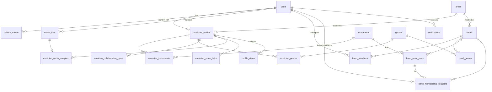

# SoundCircle — schema design

**What the database is.** Every table, column, enum, index and rule the requirements need, grouped by domain. [`coding-standards.md`](coding-standards.md) owns *how* each table is written in code; this document owns *what* exists. **This document wins** where they disagree.

**Status.** Only `users` (§4.1) is built: `POST /users` and `GET /users`. Everything else is designed here and not yet implemented. §8 tracks it.

## Contents

1. [Conventions](#1-conventions) · 2. [ERD](#2-erd) · 3. [Enums](#3-enums) · 4. [Tables](#4-tables) · 5. [Rules](#5-rules) · 6. [Discovery queries](#6-discovery-queries) · 7. [Requirement → table map](#7-requirement--table-map) · 8. [Build status](#8-build-status)

---

## 1. Conventions

Applies to every table below. Never repeated per table.

| Rule | Detail |
|---|---|
| Database | PostgreSQL 18, TypeORM migrations, `synchronize: false` |
| Primary key | `id int GENERATED BY DEFAULT AS IDENTITY`. Never `uuid` |
| Foreign keys | `int`, named `<table>_fk_<column>`. `ON DELETE NO ACTION` unless stated, because rows are soft-deleted rather than removed |
| Names | `snake_case` tables (plural) and columns; the TS property name is the column name |
| Enums | `smallint` holding the numeric value (§3). Values are contract: never renumbered, and a retired value stays burnt |
| Time | `timestamptz` everywhere; `date` only for a calendar day |
| Common columns | Every table ends with `row_status smallint default 1`, `created_at`, `updated_at`, `deleted_at`, `created_by`, `updated_by`, `deleted_by`, `created_ip`, `updated_ip`, `deleted_ip`. These come from `AbstractEntity` / `commonColumns` and are **not listed per table** |
| Deletes | Soft delete only (`softRemove()`, which stamps `deleted_by` / `deleted_ip`). Every read filters `deleted_at IS NULL` |
| Uniqueness | Any unique rule on a soft-deletable row is a **partial** unique index `WHERE deleted_at IS NULL`, so a deleted row frees its value |
| Constraint names | `<table>_uq_<cols>`, `<table>_idx_<cols>`, `<table>_fk_<col>`, `<table>_ck_<rule>`, pinned on the entity as well as the migration |
| Files | Binary content never touches the database. A row keeps the object-storage key (R2/S3) only (§4.3) |

`row_status` values (shared): `INACTIVE = 0`, `ACTIVE = 1`, `PENDING = 2`, `REJECTED = 3`, `ARCHIVED = 4`.

---

## 2. ERD

`otp_codes` and `contact_messages` stand alone (an OTP can exist before its user does; a contact message may come from a visitor).

---

## 3. Enums

All `smallint`. The **column** they live in is given so a reader can find them in §4.

| Enum | Column(s) | Values |
|---|---|---|
| `ContactVisibility` | `users.email_visibility`, `users.phone_visibility` | `PUBLIC = 1` · `MEMBERS = 2` (any signed-in user) · `BAND_MATES = 3` (shares an active band) · `ONLY_ME = 4` |
| `OtpChannel` | `otp_codes.channel` | `SMS = 1` · `EMAIL = 2` |
| `OtpPurpose` | `otp_codes.purpose` | `PHONE_LOGIN = 1` · `VERIFY_PHONE = 2` · `VERIFY_EMAIL = 3` · `RESET_PASSWORD = 4` |
| `ExperienceLevel` | `musician_profiles.experience_level` | `BEGINNER = 1` · `INTERMEDIATE = 2` · `ADVANCED = 3` · `PROFESSIONAL = 4` |
| `Availability` | `musician_profiles.availability` | `AVAILABLE = 1` · `LIMITED = 2` · `NOT_AVAILABLE = 3` |
| `CollaborationType` | `musician_collaboration_types.collaboration_type` | `JOIN_BAND = 1` · `SESSION_WORK = 2` · `JAMMING = 3` · `ONLINE_COLLAB = 4` · `TEACHING = 5` |
| `SkillLevel` | `musician_instruments.skill_level` | same values as `ExperienceLevel` |
| `MediaPurpose` | `media_files.purpose` | `PROFILE_PHOTO = 1` · `AUDIO_SAMPLE = 2` · `BAND_LOGO = 3` |
| `MediaStatus` | `media_files.status` | `PENDING_UPLOAD = 1` · `READY = 2` |
| `VideoProvider` | `musician_video_links.provider` | `YOUTUBE = 1` · `VIMEO = 2` |
| `BandMemberRole` | `band_members.role` | `OWNER = 1` · `MEMBER = 2` |
| `BandLeaveReason` | `band_members.leave_reason` | `LEFT = 1` · `REMOVED = 2` |
| `OpenRoleStatus` | `band_open_roles.status` | `OPEN = 1` · `FILLED = 2` · `CLOSED = 3` |
| `MembershipRequestType` | `band_membership_requests.type` | `INVITATION = 1` (band → musician) · `JOIN_REQUEST = 2` (musician → band) |
| `MembershipRequestStatus` | `band_membership_requests.status` | `PENDING = 1` · `ACCEPTED = 2` · `DECLINED = 3` · `CANCELLED = 4` · `EXPIRED = 5` |
| `NotificationType` | `notifications.type` | `INVITATION_RECEIVED = 1` · `INVITATION_ACCEPTED = 2` · `INVITATION_DECLINED = 3` · `JOIN_REQUEST_RECEIVED = 4` · `JOIN_REQUEST_ACCEPTED = 5` · `JOIN_REQUEST_DECLINED = 6` · `REMOVED_FROM_BAND = 7` · `PROFILE_VIEWED = 8` |
| `ContactMessageStatus` | `contact_messages.status` | `NEW = 1` · `READ = 2` · `RESOLVED = 3` |

---

## 4. Tables

Column lists omit `id` and the common columns (§1).

### 4.1 Identity and auth

#### `users` ✅ built

One row per account, however it signed up (email + password, Google, phone OTP).

| Column | Type | Null | Notes |
|---|---|---|---|
| `name` | `varchar(100)` | no | Display name. Profile setup step 1 edits it |
| `email` | `varchar(255)` | yes | Stored lower-cased |
| `phone` | `varchar(20)` | yes | E.164, e.g. `+8801712345678` |
| `password_hash` | `varchar(255)` | yes | `scrypt$<salt>$<hash>`. Null for Google- or phone-only accounts. **Never selected by a read** |
| `google_id` | `varchar(64)` | yes | Google `sub` claim |
| `email_verified_at` | `timestamptz` | yes | |
| `phone_verified_at` | `timestamptz` | yes | |
| `email_visibility` | `smallint` | no | `ContactVisibility`, default `ONLY_ME (4)` |
| `phone_visibility` | `smallint` | no | `ContactVisibility`, default `ONLY_ME (4)` |
| `last_login_at` | `timestamptz` | yes | |

| Constraint | Definition |
|---|---|
| `users_uq_email` | unique `(email) WHERE deleted_at IS NULL` |
| `users_uq_phone` | unique `(phone) WHERE deleted_at IS NULL` |
| `users_uq_google_id` | unique `(google_id) WHERE deleted_at IS NULL` |
| `users_ck_email_or_phone` | `CHECK (email IS NOT NULL OR phone IS NOT NULL)`: an account must be reachable |

#### `refresh_tokens`

Server-side record of every issued refresh token, so tokens can be rotated and revoked. The access JWT is short-lived (15 min) and stateless; the refresh token is opaque.

| Column | Type | Null | Notes |
|---|---|---|---|
| `user_id` | `int` | no | FK `users` |
| `token_hash` | `varchar(128)` | no | SHA-256 of the token. The raw token is never stored |
| `family_id` | `varchar(36)` | no | Shared by every rotation of one sign-in. Reusing a rotated token revokes the whole family |
| `expires_at` | `timestamptz` | no | |
| `revoked_at` | `timestamptz` | yes | |
| `replaced_by_id` | `int` | yes | FK `refresh_tokens`: the token this one was rotated into |
| `user_agent` | `varchar(255)` | yes | Shown on a "your sessions" screen |

Indexes: `refresh_tokens_uq_token_hash` unique `(token_hash)` · `refresh_tokens_idx_user_id` · `refresh_tokens_idx_family_id`.

#### `otp_codes`

One-time codes for phone login and email/phone verification. `user_id` is null when a phone signs in for the first time.

| Column | Type | Null | Notes |
|---|---|---|---|
| `user_id` | `int` | yes | FK `users` |
| `channel` | `smallint` | no | `OtpChannel` |
| `purpose` | `smallint` | no | `OtpPurpose` |
| `destination` | `varchar(255)` | no | E.164 phone or lower-cased email |
| `code_hash` | `varchar(128)` | no | Never the plain code |
| `expires_at` | `timestamptz` | no | 5 minutes after issue |
| `attempt_count` | `smallint` | no | default 0. Refuse at 5 |
| `consumed_at` | `timestamptz` | yes | Set on success. A consumed code never verifies again |

Index: `otp_codes_idx_destination_purpose` on `(destination, purpose)`.

### 4.2 Reference data

Seeded, admin-editable lists. Each has `slug` for URLs and filter query strings.

#### `instruments`

| Column | Type | Null | Notes |
|---|---|---|---|
| `name` | `varchar(60)` | no | Guitar, Drums, Bass, Vocals, Keyboard, … |
| `slug` | `varchar(60)` | no | `instruments_uq_slug` unique `WHERE deleted_at IS NULL` |
| `band_role_name` | `varchar(60)` | no | The label a band role shows: Guitarist, Drummer, Bassist, Vocalist, Keyboardist |
| `sort_order` | `smallint` | no | default 0 |

⚠ **A band role is an instrument.** "Add roles: guitarist, drummer, …" is `band_open_roles.instrument_id` → `instruments.band_role_name`, so a role search and an instrument search are the same query. "Vocals" is an instrument row for this reason.

#### `genres`

| Column | Type | Null | Notes |
|---|---|---|---|
| `name` | `varchar(60)` | no | |
| `slug` | `varchar(60)` | no | `genres_uq_slug` unique `WHERE deleted_at IS NULL` |
| `sort_order` | `smallint` | no | default 0 |

#### `areas`

A city or neighbourhood users pick from, with a centre point for distance sorting.

| Column | Type | Null | Notes |
|---|---|---|---|
| `parent_id` | `int` | yes | FK `areas`: city → neighbourhood |
| `name` | `varchar(100)` | no | |
| `slug` | `varchar(100)` | no | `areas_uq_slug` unique `WHERE deleted_at IS NULL` |
| `latitude` | `numeric(9,6)` | no | Centre point |
| `longitude` | `numeric(9,6)` | no | |

### 4.3 Media

#### `media_files`

Every uploaded binary: profile photos, audio samples, band logos. Uploads go **straight from the browser to R2/S3** with a presigned URL:

1. `POST /media/upload-url` creates a `PENDING_UPLOAD` row and returns a presigned PUT URL plus the row id.
2. The client PUTs the bytes to storage.
3. `POST /media/:id/confirm` HEADs the object, checks size and type, and flips the row to `READY`.

Only a `READY` row may be attached to a profile or band. A cleanup job deletes `PENDING_UPLOAD` rows older than 24 h, along with their objects.

| Column | Type | Null | Notes |
|---|---|---|---|
| `owner_user_id` | `int` | no | FK `users` |
| `purpose` | `smallint` | no | `MediaPurpose`: sets the allowed MIME types and size limit |
| `status` | `smallint` | no | `MediaStatus`, default `PENDING_UPLOAD` |
| `storage_key` | `varchar(512)` | no | `<purpose>/<owner_user_id>/<uuid>.<ext>`. Never the user's file name |
| `mime_type` | `varchar(100)` | no | Confirmed from storage, not trusted from the client |
| `size_bytes` | `int` | yes | Set on confirm |
| `duration_seconds` | `int` | yes | Audio only |
| `original_name` | `varchar(255)` | yes | Display only |

Indexes: `media_files_uq_storage_key` unique · `media_files_idx_owner_user_id`.

### 4.4 Musician profile

#### `musician_profiles`

One per user, created at profile setup step 1. Name comes from `users.name`.

| Column | Type | Null | Notes |
|---|---|---|---|
| `user_id` | `int` | no | FK `users`. `musician_profiles_uq_user_id` unique `WHERE deleted_at IS NULL` |
| `slug` | `varchar(120)` | no | Public URL `/musicians/:slug`. `musician_profiles_uq_slug` unique `WHERE deleted_at IS NULL` |
| `headline` | `varchar(120)` | yes | Step 1 |
| `bio` | `text` | yes | Step 1, max 2,000 characters (DTO) |
| `area_id` | `int` | yes | FK `areas`. Step 1 |
| `latitude` | `numeric(9,6)` | yes | Copied from the area on save; distance sorting reads this |
| `longitude` | `numeric(9,6)` | yes | |
| `experience_level` | `smallint` | yes | `ExperienceLevel`. Step 1 |
| `years_of_experience` | `smallint` | yes | Step 1 |
| `availability` | `smallint` | yes | `Availability`. Step 1 |
| `profile_photo_id` | `int` | yes | FK `media_files` (`PROFILE_PHOTO`, `READY`). Step 3 |
| `setup_step` | `smallint` | no | default 0: the last completed step, 0–3 |
| `profile_completion` | `smallint` | no | default 0, 0–100. Recomputed by the service on every profile write (§5.3) |
| `is_discoverable` | `boolean` | no | default false. True once step 2 is done (has at least one instrument), so empty profiles stay out of search |

Indexes: `_idx_area_id` · `_idx_availability` · `_idx_experience_level` · `_idx_latitude_longitude` · `_ck_profile_completion` `CHECK (profile_completion BETWEEN 0 AND 100)`.

#### `musician_instruments` — step 2

| Column | Type | Null | Notes |
|---|---|---|---|
| `musician_profile_id` | `int` | no | FK `musician_profiles` |
| `instrument_id` | `int` | no | FK `instruments` |
| `skill_level` | `smallint` | yes | `SkillLevel` |
| `is_primary` | `boolean` | no | default false. At most one per profile |

Indexes: `_uq_musician_profile_id_instrument_id` unique `WHERE deleted_at IS NULL` · `_uq_musician_profile_id_primary` unique `(musician_profile_id) WHERE is_primary AND deleted_at IS NULL` · `_idx_instrument_id`.

#### `musician_genres` — step 2

| Column | Type | Null | Notes |
|---|---|---|---|
| `musician_profile_id` | `int` | no | FK `musician_profiles` |
| `genre_id` | `int` | no | FK `genres` |

Indexes: `_uq_musician_profile_id_genre_id` unique `WHERE deleted_at IS NULL` · `_idx_genre_id`.

#### `musician_collaboration_types` — step 1

What the musician is open to. Backs the "collaboration" filter.

| Column | Type | Null | Notes |
|---|---|---|---|
| `musician_profile_id` | `int` | no | FK `musician_profiles` |
| `collaboration_type` | `smallint` | no | `CollaborationType` |

Indexes: `_uq_musician_profile_id_collaboration_type` unique `WHERE deleted_at IS NULL` · `_idx_collaboration_type`.

#### `musician_audio_samples` — step 3

| Column | Type | Null | Notes |
|---|---|---|---|
| `musician_profile_id` | `int` | no | FK `musician_profiles` |
| `media_file_id` | `int` | no | FK `media_files` (`AUDIO_SAMPLE`, `READY`). `_uq_media_file_id` unique `WHERE deleted_at IS NULL` |
| `title` | `varchar(120)` | no | |
| `sort_order` | `smallint` | no | default 0 |

Limit: 5 per profile, enforced in the service.

#### `musician_video_links` — step 3

| Column | Type | Null | Notes |
|---|---|---|---|
| `musician_profile_id` | `int` | no | FK `musician_profiles` |
| `provider` | `smallint` | no | `VideoProvider` |
| `external_video_id` | `varchar(32)` | no | Parsed from the URL on save; the embed is built from this, never from the raw URL |
| `url` | `varchar(512)` | no | As entered |
| `title` | `varchar(120)` | yes | |
| `sort_order` | `smallint` | no | default 0 |

Index: `_uq_musician_profile_id_provider_external_video_id` unique `WHERE deleted_at IS NULL`. Limit: 5 per profile.

### 4.5 Bands

#### `bands`

| Column | Type | Null | Notes |
|---|---|---|---|
| `name` | `varchar(100)` | no | |
| `slug` | `varchar(120)` | no | Public URL `/bands/:slug`. `bands_uq_slug` unique `WHERE deleted_at IS NULL` |
| `logo_id` | `int` | yes | FK `media_files` (`BAND_LOGO`, `READY`) |
| `bio` | `text` | yes | |
| `area_id` | `int` | no | FK `areas` |
| `latitude` | `numeric(9,6)` | no | Copied from the area |
| `longitude` | `numeric(9,6)` | no | |
| `setup_step` | `smallint` | no | default 0. Drives the creation progress bar: 1 details, 2 genres, 3 roles, 4 invitations sent |

⚠ **No `owner_id` column.** Ownership is the `band_members` row with `role = OWNER` (§4.5 `band_members`), so it cannot disagree with membership. `created_by` records who created the band.

#### `band_genres`

| Column | Type | Null | Notes |
|---|---|---|---|
| `band_id` | `int` | no | FK `bands` |
| `genre_id` | `int` | no | FK `genres` |

Index: `_uq_band_id_genre_id` unique `WHERE deleted_at IS NULL`.

#### `band_members`

Membership history. A current member is a row with `left_at IS NULL`.

| Column | Type | Null | Notes |
|---|---|---|---|
| `band_id` | `int` | no | FK `bands` |
| `user_id` | `int` | no | FK `users` |
| `role` | `smallint` | no | `BandMemberRole` |
| `instrument_id` | `int` | yes | FK `instruments`: what they play in this band |
| `joined_at` | `timestamptz` | no | |
| `left_at` | `timestamptz` | yes | |
| `leave_reason` | `smallint` | yes | `BandLeaveReason` |
| `removed_by_user_id` | `int` | yes | FK `users`. Set when `leave_reason = REMOVED` |

| Constraint | Definition |
|---|---|
| `band_members_uq_band_id_user_id_current` | unique `(band_id, user_id) WHERE left_at IS NULL AND deleted_at IS NULL`: one live membership per person |
| `band_members_uq_band_id_owner` | unique `(band_id) WHERE role = 1 AND left_at IS NULL AND deleted_at IS NULL`: **exactly one owner** at a time |
| `band_members_ck_left` | `CHECK ((left_at IS NULL) = (leave_reason IS NULL))` |
| `band_members_idx_user_id` | "My bands" on the dashboard |

#### `band_open_roles`

The roles a band is looking for.

| Column | Type | Null | Notes |
|---|---|---|---|
| `band_id` | `int` | no | FK `bands` |
| `instrument_id` | `int` | no | FK `instruments`, shown as `band_role_name` |
| `description` | `varchar(500)` | yes | |
| `status` | `smallint` | no | `OpenRoleStatus`, default `OPEN` |
| `filled_by_user_id` | `int` | yes | FK `users`. Set when an accepted request fills it |

Index: `_idx_band_id_status`.

#### `band_membership_requests`

One table for **both directions**: invitations (band → musician) and join requests (musician → band). The dashboard's incoming/outgoing lists and the owner's join-request queue all read it.

| Column | Type | Null | Notes |
|---|---|---|---|
| `band_id` | `int` | no | FK `bands` |
| `user_id` | `int` | no | FK `users`: the musician, in both directions |
| `type` | `smallint` | no | `MembershipRequestType` |
| `open_role_id` | `int` | yes | FK `band_open_roles` |
| `instrument_id` | `int` | yes | FK `instruments` |
| `message` | `varchar(1000)` | yes | |
| `status` | `smallint` | no | `MembershipRequestStatus`, default `PENDING` |
| `sent_by_user_id` | `int` | no | FK `users`: the owner for an invitation, the musician for a request |
| `responded_by_user_id` | `int` | yes | FK `users` |
| `responded_at` | `timestamptz` | yes | |
| `expires_at` | `timestamptz` | no | 30 days after send. A sweep marks overdue rows `EXPIRED` |

| Constraint | Definition |
|---|---|
| `_uq_band_id_user_id_pending` | unique `(band_id, user_id) WHERE status = 1 AND deleted_at IS NULL`: no duplicate open invitation/request |
| `_idx_user_id_status` | musician's incoming invitations / outgoing requests |
| `_idx_band_id_status` | owner's outgoing invitations / incoming requests |

**Accepting** runs in one transaction: lock the request row → re-check `PENDING` → set `ACCEPTED` → insert `band_members` → fill `open_role_id` → insert the notification. A second accept loses the lock race and gets 409.

| Viewer | Incoming | Outgoing |
|---|---|---|
| Musician | `type = INVITATION AND user_id = me` | `type = JOIN_REQUEST AND user_id = me` |
| Band owner | `type = JOIN_REQUEST AND band_id IN (my owned bands)` | `type = INVITATION AND band_id IN (my owned bands)` |

### 4.6 Activity

#### `notifications`

| Column | Type | Null | Notes |
|---|---|---|---|
| `user_id` | `int` | no | FK `users`: the recipient |
| `type` | `smallint` | no | `NotificationType` |
| `actor_user_id` | `int` | yes | FK `users` |
| `band_id` | `int` | yes | FK `bands` |
| `membership_request_id` | `int` | yes | FK `band_membership_requests` |
| `data` | `jsonb` | yes | Render-only extras. Never queried |
| `read_at` | `timestamptz` | yes | |

Index: `notifications_idx_user_id_read_at`, which serves the unread badge and the dashboard list.

#### `profile_views`

At most one row per viewer, per profile, per day. That is enough for a "profile views" count without storing every page hit.

| Column | Type | Null | Notes |
|---|---|---|---|
| `musician_profile_id` | `int` | no | FK `musician_profiles` |
| `viewer_user_id` | `int` | yes | FK `users`. Null for a visitor |
| `viewer_key` | `varchar(64)` | no | `u:<user_id>`, or `a:<sha256(ip + user agent + daily salt)>` for a visitor. Raw IPs are never stored here |
| `view_date` | `date` | no | |

Index: `profile_views_uq_profile_viewer_date` unique `(musician_profile_id, viewer_key, view_date)`, so the insert is `ON CONFLICT DO NOTHING`. An owner viewing their own profile is not recorded.

### 4.7 Public site

#### `contact_messages`

| Column | Type | Null | Notes |
|---|---|---|---|
| `user_id` | `int` | yes | FK `users`, when signed in |
| `name` | `varchar(100)` | no | |
| `email` | `varchar(255)` | no | |
| `subject` | `varchar(200)` | no | |
| `message` | `text` | no | Max 5,000 characters (DTO) |
| `status` | `smallint` | no | `ContactMessageStatus`, default `NEW` |

Landing, How It Works, About, Community Guidelines and Privacy Policy are **static frontend pages**, with no table. SEO (SSR/ISR, meta tags, Open Graph) is frontend work too. The database supplies the `slug` on profiles and bands, and `updated_at` for sitemap `lastmod` and ISR revalidation.

---

## 5. Rules

### 5.1 Contact visibility

`users.email_visibility` / `phone_visibility` decide whether a reader sees the value. **It is applied in the repository's SELECT**: a hidden value comes back as `null`, never fetched and then dropped.

| Setting | Visitor | Signed-in user | Band mate (active member of a shared band) | Self |
|---|---|---|---|---|
| `PUBLIC` | ✅ | ✅ | ✅ | ✅ |
| `MEMBERS` | — | ✅ | ✅ | ✅ |
| `BAND_MATES` | — | — | ✅ | ✅ |
| `ONLY_ME` | — | — | — | ✅ |

⚠ A masked column is **not sortable or searchable**. Ordering or filtering by a hidden email leaks it one comparison at a time.

### 5.2 Permissions

| Action | Visitor | Signed-in | Band member | Band owner |
|---|---|---|---|---|
| Search musicians, view public profiles / bands | ✅ | ✅ | ✅ | ✅ |
| Edit own profile, upload media | — | ✅ (own only) | ✅ | ✅ |
| Create a band (creator becomes `OWNER`) | — | ✅ | ✅ | ✅ |
| Send a join request | — | ✅ | — (already a member) | — |
| See member-only band view (full member list, contact per §5.1) | — | — | ✅ | ✅ |
| Leave the band | — | — | ✅ | — (transfer ownership first) |
| Edit band details, logo, genres, open roles | — | — | — | ✅ |
| Send invitations, accept/decline join requests | — | — | — | ✅ |
| Remove a member (UI confirms first; writes `left_at`, `leave_reason = REMOVED`) | — | — | — | ✅ |
| Delete the band | — | — | — | ✅ |

Roles are read from `band_members` on every request. **There is no permission table**: two roles do not justify an RBAC catalogue. If an admin back-office arrives, it gets its own.

### 5.3 Profile completion

Recomputed and stored on every profile write, so the dashboard and discovery read a column rather than compute it:

| Item | Weight |
|---|---|
| Headline | 10 |
| Bio | 15 |
| Area | 10 |
| Experience level + availability | 10 |
| ≥ 1 instrument | 20 |
| ≥ 1 genre | 10 |
| Profile photo | 15 |
| ≥ 1 audio sample or video link | 10 |
| **Total** | **100** |

### 5.4 Suggested musicians

Computed on the fly, not stored: discoverable profiles that share a genre with the user, play an instrument the user's bands have an `OPEN` role for, and are within 50 km. Ranked by overlap count, then distance. Users already in a band with the viewer are excluded.

---

## 6. Discovery queries

`GET /musicians` (public) reads `users` ⨝ `musician_profiles WHERE is_discoverable AND deleted_at IS NULL`.

| Filter | Predicate |
|---|---|
| `search` | `users.name ILIKE :q` **or** `EXISTS` an instrument with `name ILIKE :q`. Name search uses a `pg_trgm` GIN index `users_idx_name_trgm` (raw SQL in the migration; TypeORM cannot model it, so `migration:generate` will propose dropping it, and that proposal must be rejected) |
| `instrument_ids[]` | `EXISTS (musician_instruments … instrument_id IN (:ids))` |
| `genre_ids[]` | `EXISTS (musician_genres … genre_id IN (:ids))` |
| `area_id` | `area_id = :id` or a child area (`areas.parent_id`) |
| `experience_levels[]` | `experience_level IN (:levels)` |
| `availability[]` | `availability IN (:values)` |
| `collaboration_types[]` | `EXISTS (musician_collaboration_types …)` |
| `lat`, `lng`, `radius_km` | haversine distance ≤ radius |

Sort: `distance` (needs `lat`/`lng`; haversine over `latitude`/`longitude`), `newest` (`created_at`), `completion` (`profile_completion`). Default: `completion DESC`. Pagination is the shared `page_no` / `page_size` contract.

⚠ **Switch to PostGIS when the haversine scan gets slow.** Add a `geography(Point)` column with a GiST index and use `ST_DWithin`. Like the trigram index, it is invisible to `migration:generate`.

---

## 7. Requirement → table map

| Requirement | Tables |
|---|---|
| Public pages, SEO | none (frontend); `slug` + `updated_at` on `musician_profiles`, `bands` |
| Contact | `contact_messages` |
| Musician discovery | `musician_profiles`, `musician_instruments`, `musician_genres`, `musician_collaboration_types`, `areas`, `instruments`, `genres` |
| Public / member / owner profile views | `musician_profiles`, `bands`, `band_members` + §5.1, §5.2 |
| Signup / login (email, Google, phone OTP) | `users`, `otp_codes` |
| JWT access + refresh, route guards | `refresh_tokens` (access tokens are stateless) |
| Email / phone visibility | `users.email_visibility`, `users.phone_visibility` |
| Profile setup steps 1–3 | `musician_profiles`, `musician_collaboration_types` · `musician_instruments`, `musician_genres` · `media_files`, `musician_audio_samples`, `musician_video_links` |
| Profile completion % | `musician_profiles.profile_completion` (§5.3) |
| Dashboard | `profile_completion`, `band_membership_requests`, `band_members`, §5.4, `notifications`, `profile_views` |
| Create band, roles, invitations | `bands`, `band_genres`, `band_open_roles`, `band_membership_requests` |
| Band management | `band_members`, `band_membership_requests`, `bands` |
| Owner vs member permissions | `band_members.role` (§5.2) |

---

## 8. Build status

| Table | Status |
|---|---|
| `users` | ✅ entity, migration, repository, `POST /api/v1/users`, `GET /api/v1/users` |
| everything else in §4 | ⬜ designed, not built |

**Built routes** (public, since auth does not exist yet):

| Route | Does |
|---|---|
| `POST /api/v1/users` | Creates a user. Body: `name`, `email` and/or `phone`, `password` (required with `email`), optional `email_visibility` / `phone_visibility`. Hashes the password; 400 on a taken email/phone, 409 if a concurrent create wins the race |
| `GET /api/v1/users` | Lists users. `search` (name), `row_status`, `page_no` / `page_size`, `sort_order_by[]` on `id`, `name`, `created_at`. `email` / `phone` are returned only when `PUBLIC`, because every caller is a visitor until auth lands |
